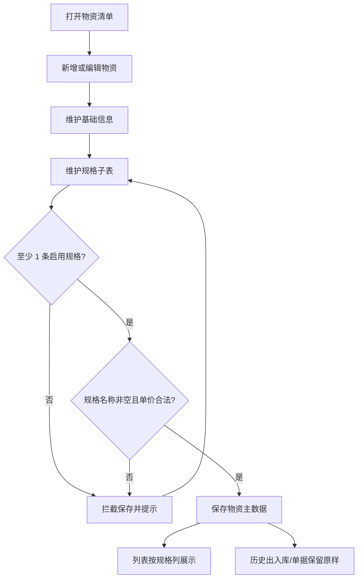
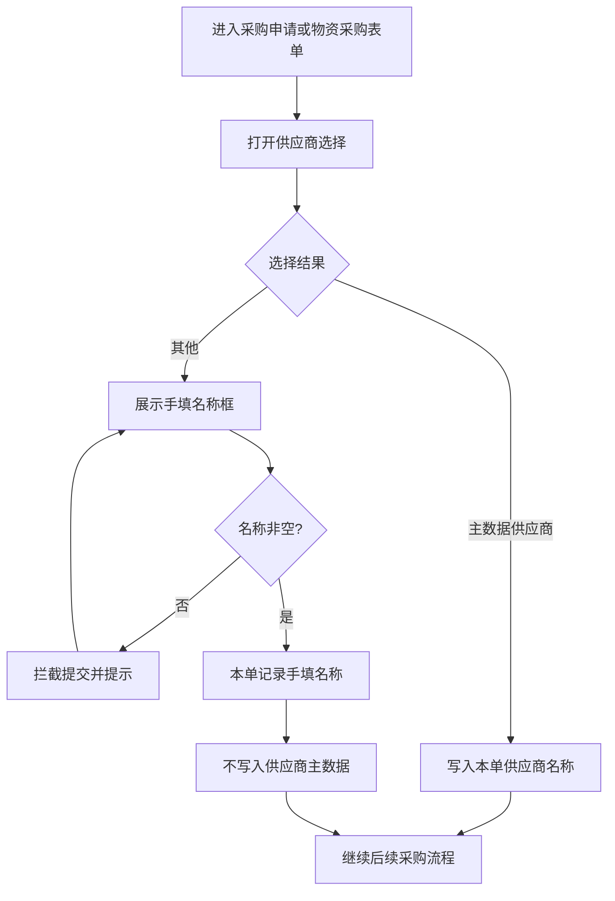
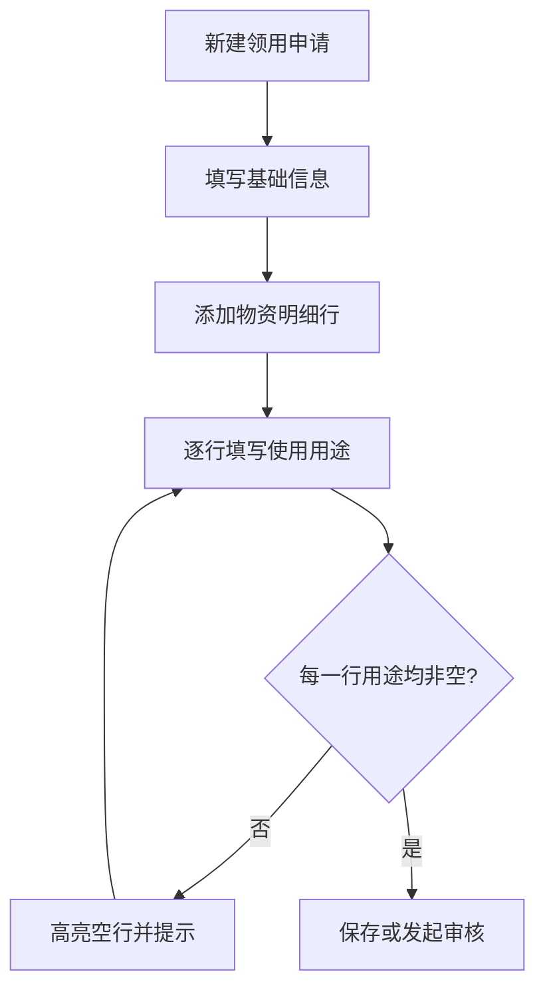

# 物资仓库管理系统（WMS）产品需求文档

| 属性 | 内容 |
|------|------|
| **版本号** | v2.0.0 |
| 产品版本 | V2.0.0 |
| **版本更新时间** | 2026-11-18 |
| **版本迭代说明** | 物资清单多规格（规格单独成列 + 固定单价）；采购申请/物资采购供应商「其他」手填；领用申请行级「使用用途」必填 |
| 关联上一版本 | v1.2.0（本版仅描述 V2.0.0 增量范围，不重复 V1 全量模块） |
| 目标平台 | PC Web |
| 交互原型 | [全局总入口](../../../prototype/index.html) · [v2.0.0 门户](../../../prototype/versions/v2.0.0/index.html) · [本版阅读页](./prd.html) |
| 文档状态 | 本期交付版（仅本次迭代范围） |
| 最后更新 | 2026-11-18 |

---

## 目录

- [1. 结论前置](#1-结论前置)
- [2. 产品概述](#2-产品概述)
- [3. 业务流程](#3-业务流程)
- [4. 功能需求](#4-功能需求)
- [5. 页面清单](#5-页面清单)
- [6. 边界 / 异常 / 兜底](#6-边界--异常--兜底)
- [7. 风险项](#7-风险项)
- [8. 待确认](#8-待确认)

---

## 1. 结论前置

本版 **V2.0.0** 聚焦四项 PC 端能力增强，继承 V1 既有流程与权限框架，不新增消息中心、审批流改造、角色权限体系页面。

| 优先级 | 范围 | 一句话目标 |
|--------|------|------------|
| P0 | 物资清单多规格 | 同一物资编码下维护多条规格，规格单独成列，各规格固定单价；历史单据不回溯改写 |
| P0 | 采购申请 · 供应商「其他」 | 下拉可选「其他」，手填供应商名称，仅记本单，不写入供应商主数据 |
| P0 | 物资采购 · 供应商「其他」 | 直采/询价/招标报价行供应商可选「其他」并手填；下拉浮层避免表格遮挡 |
| P0 | 领用申请 · 使用用途 | 申请物资每一行必填「使用用途」（非整单一个字段） |

---

## 2. 产品概述

### 2.1 版本定位

| 项 | 说明 |
|----|------|
| 产品 | 物资仓库管理系统（WMS） |
| 本版定位 | 主数据规格精细化 + 采购临时供应商兜底 + 领用用途可追溯 |
| 不在本版 | 库存算法改造、审批引擎改造、移动端、消息中心、权限矩阵重构 |

### 2.2 用户角色（沿用 V1，本版涉及）

| 角色 | 本版相关操作 |
|------|--------------|
| 基础配置管理员 | 维护物资清单及多规格固定单价 |
| 采购员 | 采购申请、物资采购（直采/询价/招标）选择或手填供应商 |
| 领用申请人 | 发起领用申请并按物资行填写使用用途 |
| 部门负责人 / 审批人 | 【待确认】审批单据时是否强制展示行级用途 |

### 2.3 核心概念

| 术语 | 定义 |
|------|------|
| 物资编码 | 物资主数据唯一编码；**不**因规格追加后缀 |
| 规格 | 物资下的规格行，列表独立列展示；同一物资可有多条 |
| 固定单价 | 规格行上维护的参考/固定单价，按规格独立 |
| 供应商「其他」 | 非主数据名单内的临时供应商，手填名称后仅落本单 |
| 使用用途 | 领用申请明细行字段，说明该行物资的具体用途 |

---

## 3. 业务流程

### 3.1 物资多规格维护

**文字解读：** 规格在子表维护，不写入编码后缀；保存前校验启用规格数量与必填；历史记录不因本次主数据变更而改写。

### 3.2 采购选供应商（含「其他」）

**文字解读：** 「其他」为兜底入口；手填值只服务当前单据，禁止自动建档。

### 3.3 领用申请行级用途

**文字解读：** 用途跟物资行走；整单不再设置统一「使用用途」字段。

---

## 4. 功能需求

### 4.1 物资清单 · 多规格与固定单价（P0）

#### 4.1.1 需求说明

| 项 | 内容 |
|----|------|
| 目标 | 支持一物多规格，规格独立列；各规格维护固定单价 |
| 端 | PC |
| 页面 | 列表 / 新增编辑 / 详情 |

#### 4.1.2 字段与规则

| 字段 | 位置 | 必填 | 规则 | 优先级 |
|------|------|------|------|--------|
| 物资编码 | 主表 | 是 | 系统生成或沿用既有规则；**禁止**规格后缀拼入编码 | P0 |
| 规格名称 | 规格子表 | 是 | 文本；同一物资下建议唯一【待确认：是否系统强校验唯一】 | P0 |
| 固定单价（元） | 规格子表 | 是 | ≥ 0 数值；按规格独立 | P0 |
| 启用状态 | 规格子表 | 是 | 启用/停用；至少保留 1 条启用规格 | P0 |
| 规格备注 | 规格子表 | 否 | 文本 | P2 |

#### 4.1.3 列表展示

| 列 | 说明 | 优先级 |
|----|------|--------|
| 规格 | 独立列；多规格可展示汇总文案或首条+数量提示【待确认：多规格单元格展示格式】 | P0 |
| 固定单价 | 可展示区间（最低～最高）或单值 | P0 |

#### 4.1.4 历史数据

| 场景 | 处理 | 优先级 |
|------|------|--------|
| 已发生出入库 / 采购 / 领用单据 | **保留原记录不动**，不因规格结构调整回溯改写 | P0 |
| 旧单规格展示 | 继续显示单据落库时的规格文本【待确认】 | P1 |

---

### 4.2 采购申请 · 供应商「其他」（P0）

#### 4.2.1 需求说明

| 项 | 内容 |
|----|------|
| 页面 | 采购申请新建/编辑表单 |
| 字段 | 推荐供应商（必填） |
| 交互 | 下拉含主数据供应商 +「其他」；选「其他」后出现「供应商名称」必填输入框 |

#### 4.2.2 规则

| 类型 | 规则 | 优先级 |
|------|------|--------|
| 正常 | 选主数据供应商 → 直接落单 | P0 |
| 正常 | 选「其他」→ 手填名称必填 → 落本单 | P0 |
| 约束 | 手填名称 **不** 写入供应商主数据 | P0 |
| 校验 | 未选供应商，或选「其他」未填名称 → 拦截确定 | P0 |

---

### 4.3 物资采购 · 供应商「其他」与下拉体验（P0）

#### 4.3.1 需求说明

| 项 | 内容 |
|----|------|
| 页面 | 直采 / 询价 / 招标执行表单中的报价供应商行 |
| 交互 | 可搜索下拉；列表底部固定「其他（手动输入）」；选中后行内手填名称 |

#### 4.3.2 规则

| 类型 | 规则 | 优先级 |
|------|------|--------|
| 正常 | 选主数据供应商；同物资下供应商不可重复 | P0 |
| 正常 | 选「其他」→ 手填名称；仅记本单 | P0 |
| 体验 | 下拉使用浮层定位，避免被表格单元格遮挡/裁切 | P0 |
| 体验 | 「其他」钉在面板底部，不埋在滚动列表中 | P0 |

---

### 4.4 领用申请 · 行级使用用途（P0）

#### 4.4.1 需求说明

| 项 | 内容 |
|----|------|
| 页面 | 领用申请表单 · 申请物资明细表 |
| 字段 | 使用用途（行级，单行文本，必填） |
| 列位置 | 「计划领用日期」之后、「备注」之前 |
| 整单 | **不** 再提供整单级「使用用途」 |

#### 4.4.2 规则

| 类型 | 规则 | 优先级 |
|------|------|--------|
| 正常 | 每一行物资各自填写用途 | P0 |
| 校验 | 任一行用途为空 → 高亮该行输入框并提示，拦截保存/发起审核 | P0 |
| 与事由关系 | 「申请事由」仍为整单分类下拉；用途为行级自由文本，二者并存 | P0 |

---

### 4.5 非本版范围（明确不做）

| 项 | 说明 |
|----|------|
| 消息中心 / 审批流页面改造 | 禁止纳入本版原型与需求正文扩展 |
| 供应商主数据自动建档 | 「其他」手填禁止回写主数据 |
| 物资编码后缀化规格 | 已否决；规格必须单独成列 |
| 领用用途整单字段 | 已否决；改为行级 |

---

## 5. 页面清单

| 端 | 页面 | 文件 | 本版要点 |
|----|------|------|----------|
| PC | 原型门户 | `prototype/versions/v2.0.0/index.html` | 入口聚合 |
| PC | 物资清单列表 | `pages/config_material_catalog.html` | 规格列 / 单价 |
| PC | 物资新增编辑 | `pages/config_material_form.html` | 规格子表 |
| PC | 物资详情 | `pages/config_material_detail.html` | 规格明细 |
| PC | 采购申请列表 | `pages/purchase_request_list.html` | 导航承载 |
| PC | 采购申请表单 | `pages/purchase_request_form.html` | 供应商「其他」 |
| PC | 物资采购列表 | `pages/purchase_execute_list.html` | 导航承载 |
| PC | 直采/询价/招标 | `pages/purchase_execute_*.html` | 供应商「其他」+ 浮层 |
| PC | 领用申请列表 | `pages/apply_requisition_list.html` | 导航承载 |
| PC | 领用申请表单 | `pages/apply_requisition_form.html` | 行级使用用途 |
| PC | 添加领用物资 | `pages/apply_requisition_add_material.html` | 选物资辅助页 |

---

## 6. 边界 / 异常 / 兜底

### 6.1 正常流程

| 场景 | 处理 | 优先级 |
|------|------|--------|
| 新增多规格物资并保存 | 列表可见规格列与单价信息 | P0 |
| 采购选主数据供应商提交 | 本单记录该供应商 | P0 |
| 采购选「其他」并手填后提交 | 本单记录手填名；主数据无新增 | P0 |
| 领用每行填用途后发起审核 | 校验通过并进入后续流程 | P0 |

### 6.2 边界情况

| 场景 | 处理 | 优先级 |
|------|------|--------|
| 规格全部停用 | 不允许保存；提示至少 1 条启用 | P0 |
| 同一物资下选重复供应商 | 提示不可重复并阻止选中 | P0 |
| 「其他」手填名与已有主数据重名 | 【待确认】是否仅提示仍允许，或强制改选主数据 | P1 |
| 领用明细仅 1 行 | 该行用途仍必填 | P0 |

### 6.3 异常兜底

| 场景 | 处理 | 优先级 |
|------|------|--------|
| 选「其他」未填名称点确定 | 拦截 + 文案提示 + 聚焦输入框 | P0 |
| 领用任一行用途为空 | 拦截 + 行高亮 + 汇总提示 | P0 |
| 供应商下拉被表格遮挡 | 浮层 fixed 定位，底部固定「其他」入口 | P0 |
| 历史单据规格与新主数据不一致 | 以单据快照为准，不自动覆盖 | P0 |

---

## 7. 风险项

| 风险 | 影响 | 建议 | 优先级 |
|------|------|------|--------|
| 多规格展示口径未统一（列表单元格文案） | 用户误解库存/单价 | 评审确定「首条+N」或「全部展开」 | P1 |
| 「其他」供应商过多且无主数据 | 后续对账、评价困难 | 后续版本考虑「转正建档」流程【待确认】 | P1 |
| 行级用途与整单事由语义重叠 | 填写负担或口径混乱 | 在表单提示区说明二者分工 | P2 |
| 历史单据不回溯 | 报表按新规格聚合困难 | 报表口径单独定义【待确认】 | P1 |

---

## 8. 待确认

| 编号 | 事项 | 影响模块 |
|------|------|----------|
| T1 | 同一物资下规格名称是否系统强制唯一 | 物资清单 |
| T2 | 列表多规格单元格最终展示格式 | 物资清单 |
| T3 | 「其他」手填名与主数据重名时的策略 | 采购申请 / 物资采购 |
| T4 | 审批详情是否强制展示行级使用用途 | 领用申请 |
| T5 | 「其他」供应商后续是否允许一键转正建档 | 供应商管理（后续版本） |
| T6 | 报表按规格聚合时对历史快照的口径 | 台账 / 报表 |

---

*文档结束 · WMS V2.0.0 · 2026-11-18*
